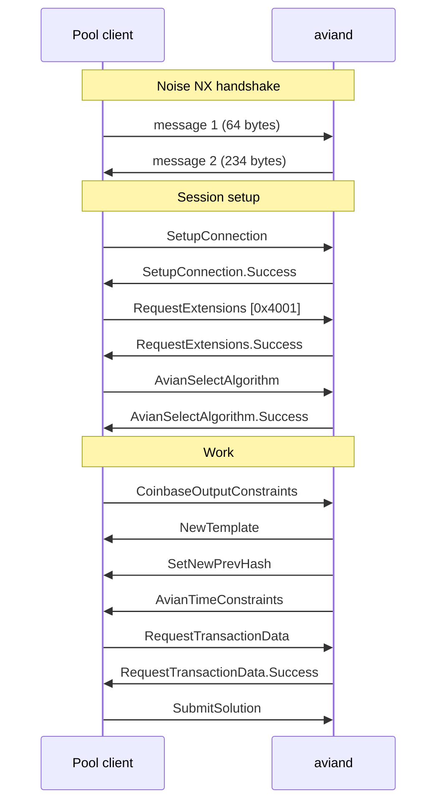
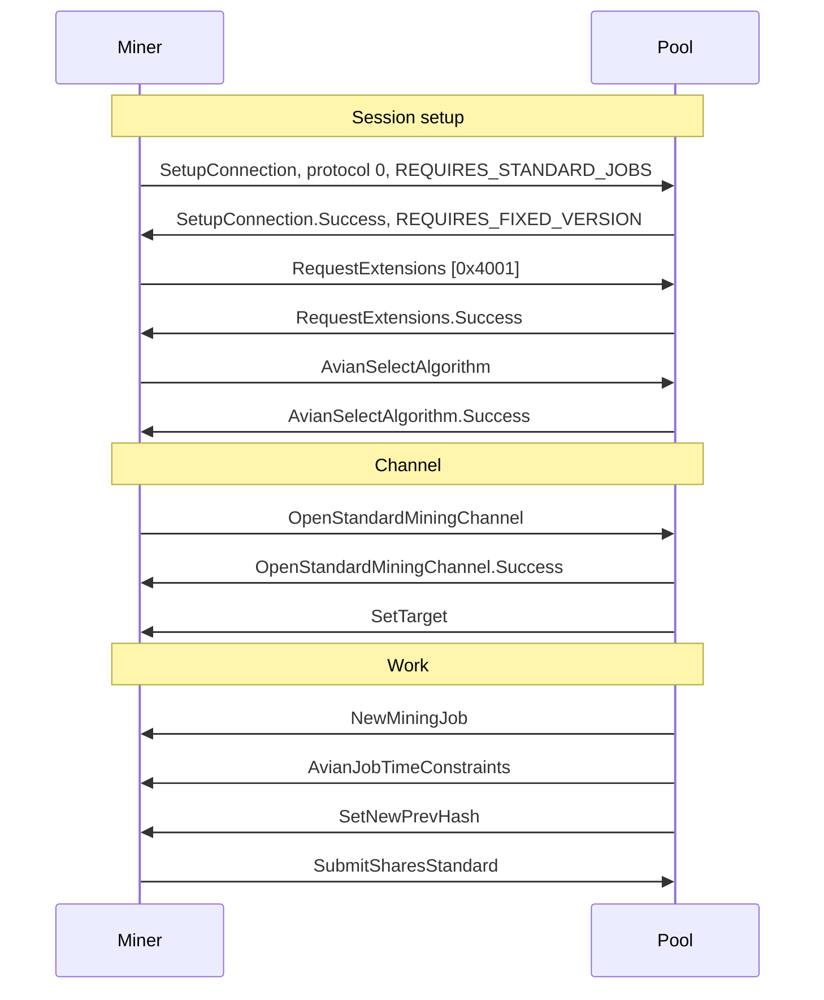
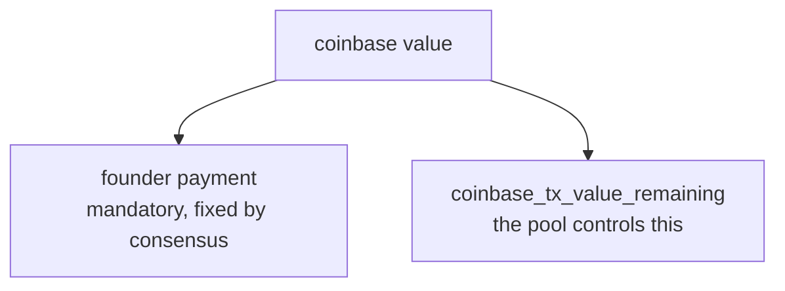

# Stratum v2 Template Provider

`aviand` can serve the Stratum v2 Template Distribution Protocol. This document
is both the operator guide and the specification of Avian's protocol extension,
because that extension is what a third-party pool or miner has to implement.
Avian keeps its own extension registry, and this document is it.

Nothing here is enabled by default, and a node started without `-sv2` behaves
exactly as it did before.

## What this is, and what it is not

`aviand` acts as a **Template Provider**. It builds block templates, announces
tip changes, serves transaction data, and accepts finished blocks. It is not a
pool: it has no concept of a worker, a share, a difficulty adjustment per miner,
or a payout.

| `aviand` | separate pool process |
| --- | --- |
| block construction | worker management |
| transaction selection | share difficulty and accounting |
| consensus rules | payouts |
| per-algorithm targets | the Stratum v2 Mining Protocol |
| founder payment | |
| template generation | |
| block submission | |

The existing JSON-RPC `getblocktemplate` and `submitblock` are untouched and
continue to work alongside this.

## Enabling it

```
-sv2                            serve the Template Distribution Protocol (default: off)
-sv2bind=<addr>[:<port>]        where to listen; repeatable (default: loopback)
-sv2port=<port>                 default port for binds that omit one
-sv2allowip=<ip>                subnet allowed to connect; repeatable
```

`-sv2bind=0.0.0.0` and `-sv2bind=[::]` listen on every interface and so
**require** `-sv2allowip`. Without one the node refuses to start, because an
empty allow list admits loopback only and the combination would otherwise
listen everywhere while serving nobody, one refused connection at a time. A
bind to a single named address needs no allow list, since choosing the
interface is itself a restriction.

Default ports are 8442 (mainnet), 18442 (testnet), 28442 (testnet4), 38442
(signet) and 18447 (regtest).

Algorithms and protocol policy:

```
-sv2powalgo=<algo>              x16rt or minotaurx; repeatable. The first given is
                                used by a client that does not select one.
-sv2extensionpolicy=<policy>    require, optional or off (default: require)
-sv2maxrejects=<n>              drop a client after this many refused solutions
-sv2maxtemplates=<n>            templates kept live per client (default: 3)
```

Timing and limits:

```
-sv2interval=<n>                seconds between refreshes when the tip has not moved
-sv2ntimeforward=<n>            how far above a template's own timestamp ntime may roll
-sv2timemargin=<n>              margin left below the consensus future-time limit
-sv2maxclients=<n>
-sv2maxclientsperip=<n>
-sv2handshaketimeout=<n>
-sv2maxsendbuffer=<n>           MiB; must hold one whole block
```

Keys, which are generated mode 0600 on first run:

```
-sv2staticprivkey=<file>        default: <datadir>/sv2_static_key
-sv2authoritykey=<file>         default: <datadir>/sv2_authority_key
-sv2certvalidity=<n>            certificate lifetime in days
```

## Security

**Exposing the Stratum v2 port is equivalent to exposing an RPC port.** It
binds to loopback by default, and that default should be changed only
deliberately.

The Noise NX handshake authenticates the **server to the client**, not the
client to the server. A client learns that it is talking to a node holding a
static key endorsed by the pool authority key; the node learns nothing about the
client. Noise is therefore transport security, not access control. Use
`-sv2allowip`, which is checked at accept time before any cryptography runs.
With no `-sv2allowip` at all, only loopback peers are admitted whatever the
bind address says, so the allow list is the thing to get right rather than the
bind.

There is **no cheap pre-filter for Avian's proof of work**. SHA256d chains let a
server do a quick partial check before committing to real work, but X16RT and
MinotaurX have no such form: the only way to know whether a submission is valid
is to compute the whole hash. The node's defence is the validation ladder in
`src/sv2/solution_check.cpp`, which rejects on every cheap field check first, a
rate limit on submissions, and the loopback default. If the port is exposed to
an untrusted network, those three are the whole defence.

### One thread serves every client

The listener has a single thread, and the provider's handlers run on it. While
a submission is being hashed, or a block serialized for a transaction-data
request, no other client is being read, written or accepted.

Bounded rather than solved, and deliberately so. Both of those handlers are
metered per client before they do any work, a submission whose proof of work
verifies is refunded so a pool finding blocks is not charged for it, and
`-sv2maxclients` bounds how many clients exist. A pool opens one connection
per algorithm, so a node serving a handful of pools is nowhere near this.

It is a real limit for a node serving many independent pools, and the fix is
to move provider work onto a worker thread so the listener does transport
only. Worth knowing before pointing a lot of unrelated pools at one node.

## Session flow



`SetupConnection.protocol` must be 2 (Template Distribution).
`AvianSelectAlgorithm` is sent once per connection, after
`RequestExtensions.Success` and before `CoinbaseOutputConstraints`. The
algorithm is immutable thereafter, because one connection carries one `nBits`
and `target` stream.

`CoinbaseOutputConstraints` must arrive before the node will issue a template,
because the coinbase size and sigop budget it declares are what the block
assembler reserves. Under-declaring it is not reported: the finished coinbase
then fails the canonical re-serialization check in `SubmitSolution` and the
submission is refused, which the protocol gives no way to explain.

Two refusal behaviours a client has to expect, neither of which is an error
reply it can simply read and carry on from:

- **`algo-already-selected` is followed by a disconnect.** The node answers the
  second `AvianSelectAlgorithm` and then closes, because a client confused
  about which algorithm it selected cannot be served safely.
- **A malformed extension message gets no reply at all.** A frame whose payload
  does not decode, including one with trailing bytes, is logged and the
  connection is closed. There is no error message for "I could not parse that",
  since replying would require knowing what was meant.

Both are visible under `-debug=sv2` and only there.

One naming note for anyone building on the Stratum v2 Reference
Implementation: the specification names `SetNewPrevHash`'s third field
`ntime_start`, in both the Template Distribution and Mining Protocols, and that
is what this document and the node use. SRI's Rust struct called the same
field `header_timestamp` until release 1.13.0, which renamed it to match. The
bytes are identical; only the label differed, and only in the older crates.

`SetNewPrevHash` accompanies a template built on a tip the client has not seen.
An in-place refresh that picks up new fees sends only `NewTemplate` and
`AvianTimeConstraints`, so a client must not assume a fixed number of messages
per round of work.

The cryptography is the Stratum v2 spec's `Noise_NX_Secp256k1+EllSwift_ChaChaPoly_SHA256`
unchanged. Its key agreement is BIP324's `v2_ecdh`, down to the
`bip324_ellswift_xonly_ecdh` tag and the role-dependent key ordering.

## The Avian extension

`extension_type = 0x4001`, negotiated through the standard Extensions
Negotiation extension `0x0001`.

### Which registry this number comes from

An `extension_type` has to be unique only among peers that can share a
connection, and an Avian connection and a Bitcoin one never do. So Avian keeps
its own extension registry, and this document is it. The identifiers below are
allocated there. They are not experimental squats and they are not a mainnet
blocker.

That is the Stratum v2 maintainers' own reading, given when this extension was
submitted to the upstream registry and declined as out of scope:

> An extension id only has to be unique among peers that can share a
> connection, and an Avian pool and a Bitcoin pool never do. A fork of this
> spec for another chain keeps its own registry, and the §3.4 rule about
> experimental ids is that fork's to restate or drop.
>
> -- stratum-mining/sv2-spec#250

Avian's registry inherits the two identifiers that must mean the same thing on
every Stratum v2 connection, because negotiation itself runs over one of them:

| `extension_type` | Extension | Allocated by |
| --- | --- | --- |
| `0x0000` | core protocol messages | Stratum v2 |
| `0x0001` | Extensions Negotiation | Stratum v2 |
| `0x4001` | algorithm selection and time-bounded work | Avian |
| `0x4002` | block notifications | Avian |

`0x4000`-`0x4fff` is Avian's allocated space. `0x5000`-`0x7fff` is what this
registry offers a third party to prototype in before asking for an allocation
here, and nothing in Avian's own tree uses it. Both of Avian's identifiers are
compile-time constants, so that distinction is asserted when the node is built
rather than checked when it starts: a build that would put a prototype
identifier on a production wire is one that should not have linked.

### Rules for every extension

Stratum v2's §3.4 says what happens to a message whose `extension_type` is
unknown: discard it. It says nothing about a message whose `extension_type` was
negotiated and whose `msg_type` is unknown, and that gap is not hypothetical.
Negotiation agrees an identifier and carries no per-extension version and no
list of supported message types, so **negotiating an extension does not
negotiate every message that extension will ever contain.** Two implementations
built at different times can agree on an identifier and disagree about what is
inside it.

Avian closes that gap for its own connections. This is a rule of the protocol
here, not of any one extension:

> **A receiving endpoint MUST ignore a message whose `extension_type` it
> negotiated and whose `msg_type` it does not recognise.** Log it and read the
> next frame. It MUST NOT be treated as a protocol violation and the connection
> MUST NOT be closed.

Three limits, all of which the first statement of this rule missed.

**It licenses optional additions only.** Ignoring an unknown message is safe
when the message is a notification a peer can do without. It is not safe for
anything that changes which work is valid: a future constraint message that
narrowed a window, silently skipped, would leave a miner producing work the
upstream will refuse, which is the exact failure `0x4001` exists to prevent.
Such a message needs explicit capability negotiation, and since the
`extension_type` is Stratum v2's only capability granularity, that means
another identifier rather than another `msg_type`.

**It binds the endpoint that receives the message.** A proxy or translating
role that forwards Stratum v2 onward MUST forward what it does not recognise
rather than discard it, or it silently strips capability from the roles behind
it. Avian has no Stratum v2 to Stratum v2 proxy today, so this is
forward-looking rather than live.

**It cannot be retrofitted.** A document cannot fix a peer that has already
shipped. Until a client carries the rule, the only safe way to add a capability
is to put it behind its own `extension_type`, so an old client never asks for
it and never receives it. `0x4002` exists for that reason, and development is
what taught it: block notifications were briefly message `0x05` of `0x4001`,
and a pool built after they existed ended the session of a miner built before,
which went on hashing into a connection nobody was serving. Both were in this
tree, weeks apart, which is as far as it got.

### TLV fields, and which way round they go

Section 3.4.3 lets an extension append Type-Length-Value fields to the end of
a message somebody else defined, without changing that message's layout or its
frame's `extension_type`. A field is a `U16` extension type, a `U8` field type,
a `U16` length and then that many bytes.

**Avian encodes those integers little-endian.** That needs saying, because the
specification contradicts itself. Section 3.1 states that multibyte data types
are *always* little-endian and lists `U16` as such, and 3.4.3 describes these
fields as `U16` and `U8`. But 3.4.3's only worked example renders extension
`0x0002`, field `0x01`, length 10 as:

```
00 02 01 00 0A ...
```

which is big-endian in both multibyte fields. Little-endian is what the
normative type table requires, so the example is read here as a documentation
error rather than as a second rule. The reference implementation agrees: the
TLV codec in SRI's `parsers_sv2` reads and writes both fields with
`from_le_bytes` and `to_le_bytes`, so that example is the only place the other
order appears.

Anyone implementing against Avian should take the rule from this paragraph and
not from that example. The same field, as Avian writes it:

```
02 00 01 0A 00 57 6F 72 6B 65 72 5F 30 30 31
```

The rest of 3.4.3 applies unchanged: fields come after everything the base
message defines, they are ordered by `extension_type`, order within one
extension is that extension's to define, and a length of zero means no value.
A receiver skips fields belonging to extensions it did not negotiate rather
than refusing them, which is the entire point of the encoding.

`-sv2extensionid` can override the identifier for interoperability testing. It
is hidden, validated `<= 0x7fff`, and **rejected on mainnet**, so a mainnet
node's wire identity is fixed by the constant alone.

The extension spans **both** the Template Distribution Protocol, which is what
`aviand` serves, and the Mining Protocol, which a pool serves to its workers.
Those are different links, but they need the same two things from Avian, for
the same reasons, so one extension covers both. `aviand` implements the
Template Distribution half; the Mining Protocol half is specified here and is
the pool's to implement.

### Why an extension is needed at all

Stock Template Distribution already carries most of what Avian needs.
`NewTemplate.version` contains `pow_type << 16`, and `SetNewPrevHash.nbits` and
`.target` are already per-algorithm. Three things are missing, and each is one
field:

1. A client cannot **ask** for an algorithm. Without that the node can only pin
   one per listening port.
2. There is no **upper bound on ntime**. The spec defines only
   `ntime >= ntime_start`. X16RT's hash chain is derived from
   `SHA256d(nTime & 0xffffff80)`, so a miner rolling ntime past a 128-second
   boundary silently computes the wrong hash function.
3. There is no way to tell a client **which version bits it may roll**. BIP323
   reserves bits 5–28 of `nVersion` as nonce space, which fully contains
   Avian's algorithm field at bits 16–23, and the Template Distribution
   Protocol says outright that a client may set those bits to any value in
   `SubmitSolution` and must not rely on the node having set them to anything.
   For Bitcoin that is free search space. For Avian, bit 16 silently moves the
   share to the other algorithm and bits 17–23 make it `bad-algo-id`.

Every one of those failure modes is silent. A miner hits none of them as an
error; it just burns hashrate and looks unlucky. That is why the extension is
required by default rather than optional.

The first two recur verbatim on the Mining Protocol. A worker has to be told
which algorithm its connection carries, and a job carries an `ntime_start` but
no maximum permitted `ntime`, so an X16RT miner rolling off the end of a job's
epoch computes the wrong hash function there too. The third does not: a
channel's algorithm never changes once it is open, so one
`version_rolling_mask` covers every job on it.

### Per-channel algorithm

`AvianSelectAlgorithm` settles the **connection's** algorithm, which is what a
channel is served on when it asks for nothing. A channel may override it for
itself by appending a TLV field to its `OpenStandardMiningChannel` or
`OpenExtendedMiningChannel`:

| field | type | value |
| --- | --- | --- |
| `0x4001`, field `0x01` | `U8` | the `pow_type` this channel carries |

So an open that asks for MinotaurX on a connection that selected X16RT ends
with:

```
01 40 01 01 00 01
```

the extension type, the field type, a length of one, and the algorithm.

A pool serves each channel the work, target and `nbits` of the algorithm that
channel asked for, on the same connection as channels asking for something
else. The reason to want that is a proxy: without it, a proxy aggregating
mixed rigs needs one upstream connection per algorithm, which is a deployment
constraint standing in for a protocol field, exactly like the one algorithm
selection exists to remove.

**A channel's algorithm is fixed for its life.** There is no message to change
it. A worker that wants a different one closes the channel and opens another,
which is cheap and leaves no question about which jobs belong to which
algorithm.

**Omitting the field means the connection's algorithm**, which is what every
miner built before this field sends, so nothing changed for them. That is the
whole reason it is a TLV field rather than a new required message: section
3.4.1 keeps the frame's `extension_type` at `0x0000` for a message the core
protocol defined, a peer that does not know the field reads the open exactly
as it always did, and there is no `request_id` matching to race.

Two refusals, with different codes because a worker can act on the difference:

| code | means |
| --- | --- |
| `unsupported-pow-type` | not a `pow_type` the chain defines, which is the worker's bug |
| `pow-type-not-enabled` | a real algorithm this pool was not configured to serve, which is the operator's |

Both are sent as `OpenMiningChannelError` and refuse that channel alone. The
connection stands and its other channels keep working, because behind a proxy
one rig asking for the wrong thing must not disconnect the rest.

A **malformed** TLV region is different and does end the connection. A peer
that cannot encode one correctly will not encode the next one correctly
either, and unlike a mistyped address it is not something an operator fixes by
retrying.

### Messages

All integers are little-endian, as everywhere in Stratum v2.

**`extension_type = 0x4001`**

| `msg_type` | Message | Direction | Protocol |
| --- | --- | --- | --- |
| `0x00` | `AvianSelectAlgorithm` | downstream → upstream | both |
| `0x01` | `AvianSelectAlgorithm.Success` | upstream → downstream | both |
| `0x02` | `AvianSelectAlgorithm.Error` | upstream → downstream | both |
| `0x03` | `AvianTimeConstraints` | upstream → downstream | template distribution |
| `0x04` | `AvianJobTimeConstraints` | upstream → downstream | mining |
| `0x05` | `AvianSubmitSolution.Success` | upstream → downstream | template distribution |
| `0x06` | `AvianSubmitSolution.Error` | upstream → downstream | template distribution |

**`extension_type = 0x4002`**

| `msg_type` | Message | Direction | Protocol |
| --- | --- | --- | --- |
| `0x00` | `BlockFound` | upstream → downstream | mining |

"Upstream" is the node for a pool, and the pool for a worker. The three
`AvianSelectAlgorithm` messages are identical on both protocols: they are
connection-scoped and carry nothing protocol-specific. Only the time
constraints differ, because the two protocols name work differently.

**`AvianSelectAlgorithm`**

| Field | Type | Meaning |
| --- | --- | --- |
| `pow_type` | `U8` | 0 = X16RT, 1 = MinotaurX |

**`AvianSelectAlgorithm.Success`**

| Field | Type | Meaning |
| --- | --- | --- |
| `pow_type` | `U8` | the algorithm now bound to this connection |
| `version_rolling_mask` | `U32` | bits of `nVersion` the client may change |

`version_rolling_mask` is **always `0`**, and there is no option to change it.
A client must submit `version` exactly as the template gave it.

The field exists, and `CheckSolution` honours a non-zero value, so a later
protocol version can allow rolling without a format change. Nothing in this
version can turn it on, because there is no durable safe subset of `nVersion`
to open. Bits 16–23 hold the algorithm, so rolling them either trips
`bad-algo-id` or silently moves the share to the other algorithm and the wrong
proof-of-work limit. Bits 29–31 are `VERSIONBITS_TOP_MASK`, which Avian also
uses to signal assets. What remains is BIP9 deployment space, where bits 2, 11,
12 and 28 are already assigned and the rest is where the next deployment will
land, so a mask chosen as safe today would not stay safe.

Set against that, rolling buys Avian nothing. Version rolling exists to give
ASICs search space beyond nonce and extranonce at very high hash rates, and
X16RT and MinotaurX are GPU and CPU algorithms where nonce plus extranonce is
ample.

**`AvianSelectAlgorithm.Error`**

| Field | Type | Meaning |
| --- | --- | --- |
| `error_code` | `STR0_255` | why the algorithm was refused |

Defined values:

| `error_code` | Meaning |
| --- | --- |
| `unsupported-pow-type` | not an algorithm this chain defines |
| `pow-type-not-enabled` | not an algorithm this node was configured to serve |
| `algo-already-selected` | a second selection on one connection |

These are normative. An extension whose only error message is "a `STR0_255`"
cannot be implemented against.

**`AvianTimeConstraints`**

| Field | Type | Meaning |
| --- | --- | --- |
| `template_id` | `U64` | the template these bounds apply to |
| `ntime_min` | `U32` | lowest acceptable `ntime`, inclusive |
| `ntime_max` | `U32` | highest acceptable `ntime`, inclusive |

Sent after every `NewTemplate`. Both bounds are **inclusive**, and they are
absolute values rather than a mask over `ntime_start`, because an in-place
refresh does not re-send `SetNewPrevHash` and so has nothing to anchor a mask
to.

`ntime_max` is the minimum of:

- X16RT only: the end of the template's 128-second epoch,
  `(nTime & 0xffffff80) + 127`
- `now + MAX_FUTURE_BLOCK_TIME_DUAL_ALGO - sv2timemargin`, where Avian's future
  limit is 1350 seconds, not Bitcoin's 7200
- `nTime + sv2ntimeforward`
- on chains that allow minimum-difficulty blocks, which is regtest and testnet,
  **`nTime` itself**: there `nBits` is a function of `nTime`, so rolling at all
  risks `bad-diff` even though the template's `nBits` was correct when issued

The node re-evaluates the future-time term when a solution arrives, so a
long-lived template cannot be used to smuggle a timestamp the chain would
reject.

**`AvianJobTimeConstraints`**

A **channel message**: bit 15 of `extension_type` is set, so this message
appears on the wire under `0xc001` while the extension it belongs to is still
`0x4001`. Bit 15 is the `channel_msg` flag and is ignored when an
implementation looks up which extension a message belongs to.

| Field | Type | Meaning |
| --- | --- | --- |
| `channel_id` | `U32` | the channel these bounds apply to |
| `job_id` | `U32` | the job these bounds apply to |
| `ntime_min` | `U32` | lowest acceptable `ntime`, inclusive |
| `ntime_max` | `U32` | highest acceptable `ntime`, inclusive |

Sent after every `NewMiningJob` or `NewExtendedMiningJob`, before the worker
can be expected to have started on it. Both bounds are **inclusive**.

This is the same information as `AvianTimeConstraints` keyed differently.
`template_id` is a Template Distribution concept and has no meaning to a
worker, so the mining form keys on the channel and job that the worker was
actually given. It is a separate message rather than a reinterpretation of the
same field so that an implementation handling both links, such as a pool, can
never confuse a template id with a job id.

**`AvianSubmitSolution.Success`** and **`AvianSubmitSolution.Error`**

The reply the Template Distribution Protocol does not have. Its message table
ends at `SubmitSolution` with no `.Success` and no `.Error`, so a client that
submits a block learns nothing from the protocol: not that the node took it,
not why it did not, and not even that it was heard.

| Field | Type | Meaning |
| --- | --- | --- |
| `template_id` | `U64` | the template the solution claimed |
| `block_hash` | `U256` | the block hash, which on Avian is the proof-of-work hash |

| Field | Type | Meaning |
| --- | --- | --- |
| `template_id` | `U64` | the template the solution claimed |
| `error_code` | `STR0_255` | why it was refused |

Defined `error_code` values, which are normative. They are also the strings the
node writes to its own log, so an operator reading a log and an implementer
reading a frame name one thing. What each requires of a client is
[What a client must reproduce](#what-a-client-must-reproduce).

| `error_code` | Meaning |
| --- | --- |
| `unknown-template` | no such template, or one this connection was never sent |
| `version-mismatch` | `version` differs from the template's |
| `bad-algo-id` | `nVersion` bits 16-23 name no algorithm this chain defines |
| `ntime-out-of-range` | outside the window `AvianTimeConstraints` gave |
| `ntime-wrong-epoch` | X16RT only: past the end of the template's 128-second epoch |
| `coinbase-too-large` | over the advertised size, weight or the block limit |
| `coinbase-malformed` | does not deserialize as a transaction |
| `coinbase-non-canonical` | deserializes, but re-serializes to different bytes |
| `coinbase-bad-scriptsig` | wrong length, or does not start with `coinbase_prefix` |
| `coinbase-bad-fields` | version, locktime or input sequence differ from the template's |
| `coinbase-bad-witness` | `vin[0]` witness is not the single 32-byte BIP141 reserved value |
| `missing-required-output` | an output from `coinbase_tx_outputs` is absent |
| `bad-commitment` | the witness commitment is wrong or is not the highest-indexed one |
| `value-too-high` | outputs exceed `coinbase_tx_value_remaining` plus the required ones |
| `too-many-sigops` | over the advertised sigop budget |
| `block-too-large` | template plus this coinbase exceeds the block limit |
| `pow-insufficient` | the proof-of-work hash does not meet this algorithm's target |
| `consensus-rejected` | passed every check here and validation refused it anyway |

`consensus-rejected` is the one worth acting on rather than retrying. It means
these checks and consensus disagree, which is a node bug, and the node logs it
at warning level for the same reason.

`.Success` means the node constructed the block and validation accepted it. It
does **not** mean the block became the tip: one that loses a race is accepted
here and then orphaned. A client learns the rest by matching `block_hash`
against the next `SetNewPrevHash`, which is also what `block_hash` is for on
the error-free path, since `template_id` cannot say which of several nonces in
flight against one template is being answered.

`.Error` carries no `block_hash`, and the asymmetry is deliberate rather than
an omission. Most refusals happen before the proof-of-work hash is computed,
because that hash costs more than every check before it put together and a few
attacker bytes must not be able to buy one. There is therefore nothing to name
the submission with. A client with several nonces in flight learns the reason
but not which nonce, which is the right way round: the reason is what it can
act on.

Two refusals are not answered. A solution that trips the rate limit is not,
because replying to a flood is amplification, and one whose payload does not
decode is not, because nothing in it can be trusted to name a template. Both
drop the connection.

A refusal that takes a client past `-sv2maxrejects` is sent **before** the
connection closes, not after. The refusal that explains a disconnect is the one
worth arriving, so the node drains the socket rather than closing it the moment
the reply is queued.

Neither message can be relied on by its absence. There is no way to ask a peer
which message numbers inside a negotiated extension it implements, so a client
cannot distinguish a node that refused silently from one built before these
existed, and must not treat silence as a verdict or run a timeout off it. Both
are positive information only, which leaves a client no worse off than it was
without them.

`ntime_min` restates the job's `ntime_start`, and the restatement is doing real
work rather than padding. Stratum v2 says of `ntime_start` that it is the
`nTime` at which hashing starts and that it **is not the consensus minimum**.
Avian's `ntime_min` is a different kind of statement: it is a lower bound on
what will be accepted, because below it the node refuses the submission. The
two carry the same number and mean different things, so the extension states
the one it enforces rather than leaving a worker to read a start value as a
rule. Carrying both bounds together also means a pool that computes the window
once cannot emit halves that disagree.

How it lines up with the job depends on whether the job is active:

```
active job, ntime_start present
    AvianJobTimeConstraints.ntime_min MUST equal NewMiningJob.ntime_start

future job, ntime_start absent
    the constraints MAY be sent with the job, if the bounds are known then
    otherwise they MUST be sent immediately before the SetNewPrevHash that
    activates the job
    either way, the ntime_start that SetNewPrevHash supplies MUST equal
    the ntime_min in force for that job
```

"Before the `SetNewPrevHash`", not after. A worker must never have an instant
in which a job is active and its `ntime_max` is unknown, because the only safe
thing it could do in that instant is idle. So the ordering is:

```
NewMiningJob                 future job
[AvianJobTimeConstraints]    optional here, if the bounds are known
...
AvianJobTimeConstraints      required here if not sent above
SetNewPrevHash               activates the job
```

A worker **must not** begin hashing an Avian job until it holds both the
applicable time constraints and the activation information.

Note that the node does the opposite on its own link, and deliberately.
`aviand` sends `NewTemplate`, then `SetNewPrevHash`, then
`AvianTimeConstraints` last. The asymmetry is not an oversight:

- A worker activated by `SetNewPrevHash` is required by Stratum v2 to start
  hashing immediately, so constraints arriving afterwards leave a real instant
  in which it is working without knowing when its work expires.
- A Template Distribution client is a pool, and it cannot do anything with a
  template until it has the whole round: the merkle path, the required
  outputs, the prev hash and the window all have to be in hand before it can
  build a single job. There is no equivalent instant.

The template in such a round is marked `future_template`, because the
`SetNewPrevHash` after it is what activates it. A refresh on an unchanged tip
is not: it carries no `SetNewPrevHash`, and the prev hash it belongs to was
announced already. So the flag says exactly whether a `SetNewPrevHash` is
still to come for that template, which is the only reading under which a
client never binds a template to a tip that has already been replaced.

Putting `AvianTimeConstraints` last on that link buys something instead. It
gives a work round an unambiguous terminator, which a blocking client needs,
because `SetNewPrevHash` is only sent when the tip moved and so cannot be used
to tell a new-tip round from an in-place refresh. `test_framework/sv2.py`
relies on exactly that: it reads until the constraints arrive and then knows
the round is complete.

A third case is the one a running pool meets most often and neither of the
above describes it: a channel that already has an active job, on a tip that has
just moved. Resolve it as the future-job case rather than the active one. Issue
a **new future job**, then its constraints, then the `SetNewPrevHash` that
activates it. Issuing an active job alongside a `SetNewPrevHash` would put the
activation and the constraints in the same breath and give a worker no moment
at which it holds one without the other.

That distinction is not optional to handle. Stratum v2 requires the first
`NewMiningJob` after a channel opens to be a future job, with `ntime_start`
unset, so every connection meets the second case before it ever meets the
first.

The same invariant already holds one link up, where `AvianTimeConstraints`
`ntime_min` equals the `ntime_start` in the `SetNewPrevHash` for that template.
`mining_sv2.py` asserts it, so a pool can rely on the node's two messages
agreeing and has only to preserve the property as it narrows.

A pool derives these bounds from the `AvianTimeConstraints` it received for the
template the job came from. It must **narrow, never widen, and never to
nothing**: on a chain that pins the window shut, which is regtest and testnet,
`ntime_min` already equals `ntime_max` and any narrowing at all leaves a worker
with no legal `ntime`. Treat an empty window as a protocol error and refuse to
issue the job rather than issuing one that cannot be worked. It must **narrow,
never widen**: the node will
refuse a solution outside its own window, and a worker that was told it had
more room than the node allows will mine work that cannot be submitted. Where a
pool holds a job open across a refresh it must re-send this message with the
new bounds.

### On the Mining Protocol

A pool serving Avian workers negotiates the same extension and then uses it on
each worker connection:



`AvianSelectAlgorithm` comes before `OpenStandardMiningChannel`, because the
channel's `nominal_hash_rate` and target only mean something once the algorithm
is known. One connection carries one algorithm, so a worker mining both opens
two connections. That is not a limitation worth engineering around: the two
algorithms have independent difficulty, independent targets and independent
job streams, and multiplexing them would make every one of those ambiguous.

### Flags on an Avian mining connection

Version rolling is a negotiated feature with a flag on each side, so stating
that it is "disabled" is not enough: the two roles set different flags, and a
pool that sets the wrong one has no contract at all.

Set by the **miner**, in `SetupConnection.flags`:

| Bit | Flag | Avian v1 |
| --- | --- | --- |
| 0 | `REQUIRES_STANDARD_JOBS` | **1**, the worker needs `NewMiningJob` |
| 1 | `REQUIRES_WORK_SELECTION` | 0, no Job Declaration |
| 2 | `REQUIRES_VERSION_ROLLING` | **0**, it must not demand rolling |

Set by the **pool**, in `SetupConnection.Success.flags`:

| Bit | Flag | Avian v1 |
| --- | --- | --- |
| 0 | `REQUIRES_FIXED_VERSION` | **1**, the version field is not negotiable |
| 1 | `REQUIRES_EXTENDED_CHANNELS` | 0, standard channels are the only kind |

`REQUIRES_STANDARD_JOBS` matters because without it a standard channel may be
served grouped or extended jobs. A worker that can only process `NewMiningJob`
has to say so.

`REQUIRES_FIXED_VERSION` is the enforceable half of "no version rolling". The
specification says that if the miner set `REQUIRES_VERSION_ROLLING` then the
pool **must not** set `REQUIRES_FIXED_VERSION`, which means the two are
mutually exclusive rather than one overriding the other. An Avian pool cannot
honour rolling at all, so a miner that demands it must be **refused** with
`SetupConnection.Error`, not answered and then quietly held to a fixed version.
Avian keeps the algorithm in `nVersion` bits 16–23, and rolling them changes
which algorithm, and so which proof-of-work limit, the share is judged under.

Note the asymmetry with the node link: Template Distribution defines no flags
at all, so `aviand` rejects any non-zero `SetupConnection.flags` with
`unsupported-feature-flags`.

### `SubmitShares.Error` codes an Avian pool must send

Stratum v2 defines no `SubmitShares.Error` codes at all. The familiar
`invalid-channel-id`, `stale-share`, `difficulty-too-low` and `invalid-job-id`
are the reference implementation's constants, and so is `invalid-version`,
which is why it is reused below rather than invented. An Avian pool has to
refuse two things none of those describe, and both are refusals this extension
exists to make possible:

| `error_code` | Meaning |
| --- | --- |
| `invalid-version` | `version` differs from the job's, which `REQUIRES_FIXED_VERSION` forbids and which would move the share to the other algorithm's proof-of-work limit |
| `invalid-ntime` | `ntime` is outside the window `AvianJobTimeConstraints` gave for that job. SRI's `invalid-ntime-start` names only the lower bound; this covers both, since a worker past either has the same thing to fix |
| `too-many-shares` | the channel exceeded its submission allowance |

`too-many-shares` is not about validity. A pool must meter submissions for the
same reason the node does, that Avian has no cheap proof-of-work pre-filter so
every share costs a whole hash, and a miner whose share target is set far below
its hashrate will reach that allowance while doing nothing wrong. The answer is
a harder share target rather than a larger allowance: the allowance exists
because the hashes are expensive, so raising it buys the same flood at the same
cost. A miner seeing this should expect its target to change, not retry.

`error_code` is a `STR0_255`, so inventing values is legal, but a miner cannot
recognise one it has never been told about. Undocumented, these two sit exactly
where the algorithm and the `ntime` bound sat before this extension existed.
They are therefore normative here, as the `AvianSelectAlgorithm.Error` values
are.

### What a pool does with a worker that clears `REQUIRES_STANDARD_JOBS`

Refuse the connection with `SetupConnection.Error`. Stratum v2 has no code for
a flag whose **absence** is the problem: `unsupported-feature-flags` names
flags that are not supported, and the `flags` field is described as naming the
flag causing the error, so using it here is a stretch a miner cannot
disambiguate. Follow the precedent of `missing-declare-tx-data-flag` and send
`missing-standard-jobs-flag`.

A v1 Avian pool serves standard jobs only, so a worker that can process
extended jobs is not the problem; a worker that has not said it needs standard
ones may be served jobs through a group it cannot interpret.

### `user_identity`, and what a solo pool reads out of it

A solo pool pays the miner directly in the coinbase, so it needs an address
from the miner. `user_identity` in `OpenStandardMiningChannel` is where it
goes: `STR0_255`, comfortably more than an Avian address needs.

**The field carries `address.workername`, and nothing says so anywhere.**
Not Stratum v2, which gives `user_identity` no structure at all, and not this
document until now. Every miner in the field puts it there because Stratum v1
did, and a pool that did not know would try to parse the whole string as an
address and refuse every real miner it met. Split on the **first** dot: no
Avian address can contain one, since neither the base58 alphabet nor the
bech32 charset includes it, so the first dot is the unambiguous end of the
address and `address.rig.1` parses correctly. A bare address with no label is
valid too.

Avian's address versions are mainnet 60 and 122, every test network 111 and
196, and the bech32 prefixes are `avn`, `tavn` for testnet and signet,
`tavn4`, and `avnrt`. So **mainnet is the only network a base58 address can be
checked against**, and off mainnet a testnet address will be accepted by a
regtest pool. The bech32 prefix separates regtest and testnet4 but not testnet
from signet. This matters little in practice, because the case worth getting
right is a mainnet pool refusing a test address, and that one works.

A pool **must refuse a channel it cannot pay** rather than fall back to a
default, a burn address or the operator's own. A miner mistyping its address
and being quietly mined to someone else's is the worst failure a solo pool
has, and it is silent.

Stratum v2 defines no `OpenMiningChannel.Error` codes either. The reference
implementation's `unknown-user`, `invalid-user-identity` and
`max-count-exceeded` are the nearest, and none of them says which way an
address is wrong, so these are normative here:

| `error_code` | Meaning |
| --- | --- |
| `missing-payout-address` | `user_identity` carried no address |
| `invalid-payout-address` | the address did not decode or failed its checksum |
| `wrong-network-address` | a valid address for another network |
| `unsupported-address-type` | a type this pool cannot pay, such as segwit v1 |

A miner that cannot tell "your address is wrong" from "the pool is full" will
retry forever against a pool that will never serve it. That is the same shape
as the algorithm and the `ntime` bound before this extension existed, and it
is the third time the gap has appeared.

### Work does not survive a reconnect


A `job_id` is unique only within the connection that issued it. Both it and
`channel_id` come from a pool's own counters, and a pool that restarts them
on a new connection, which is the obvious implementation, will reissue id 1 to
mean something else.

So a miner **must discard work in flight when a connection drops**. A nonce
found for the old job 1, submitted after reconnecting against the new job 1,
is a share computed over a different header: a different merkle root at least,
since a new `channel_id` changes the coinbase extranonce. At any realistic
difficulty it is simply rejected, and the miner has wasted both the work and
the submission. On a chain whose target is its own floor, which is regtest,
it is accepted instead, and a pool's test suite will therefore not notice the
miner is submitting work it did not do for that job.

Neither this document's extension nor Stratum v2 itself says this anywhere,
and a miner author has no way to infer it. A pool can make itself harder to
misuse by not reusing job ids across connections, but the robust rule is the
miner's, because it holds whatever the pool does.

### Two things the protocol cannot enforce for the pool

- **The target is compared against Avian's proof-of-work hash**, X16RT or
  MinotaurX, not SHA256d. This is why `SetTarget` needs no Avian field and also
  why no unmodified Stratum v2 miner can work here.
- **The pool builds the coinbase**, so the pool is what has to satisfy the
  node's submission checks. "What a client must reproduce" below is the pool's
  contract with the node, not the worker's with the pool.

`AvianJobTimeConstraints` applies to extended channels too, unchanged: a job's
ntime window does not depend on who assembles the coinbase.

### Extended channels

An earlier version of this document deferred these, on the grounds that
Stratum v2 defines `coinbase_tx_prefix` and `coinbase_tx_suffix` without the
BIP141 marker, flag and witness data while Avian's contract requires a
specific witness stack and a canonical byte-for-byte reconstruction, so the
two had to be reconciled deliberately.

**There is nothing to reconcile.** A merkle root is folded from txids and a
txid excludes witness data, so the witness-free split the specification asks
for is exactly what a miner needs:

```
pool    splits the coinbase around the extranonce, without witness
miner   inserts its extranonce, hashes the three parts to a txid,
        folds the merkle path. It never needs the witness.
pool    on a share, reconstructs the coinbase with its witness and
        submits that
```

Avian's canonical check only ever applies to what the pool submits, which the
pool controls entirely, and the witness commitment is unaffected by the
extranonce because it commits to the witness root of the other transactions
plus the coinbase's own fixed zero witness.

Three things an implementer needs that are documented nowhere:

- **The scriptSig length byte lives inside `coinbase_tx_prefix`**, before the
  extranonce bytes it counts exist. A pool that does not reserve the whole
  extranonce there produces a coinbase that is malformed for every extranonce,
  and will see only shares that never become blocks.
- **The 2-to-100-byte scriptSig is shared three ways** on an extended channel:
  the BIP34 height push, any operator tag, and the extranonce. A pool must
  refuse a `min_extranonce_size` it cannot fit rather than opening a channel
  whose every coinbase the node will reject, which with no `SubmitSolution`
  error reply would be silent. Stratum v2 has no code for that refusal; the
  reference implementation does, `min-extranonce-size-too-large`, and that
  exact string is normative here rather than a new one. It is the fourth time
  this gap has appeared.
- **`version_rolling_allowed` must be false** on `NewExtendedMiningJob`.
  `REQUIRES_FIXED_VERSION` implies it but does not state it for a message that
  carries its own flag, and a client should refuse a job that sets it rather
  than ignore a permission it cannot honour safely.

### What a miner can actually verify

Worth stating precisely, because it is the argument for preferring extended
channels and it is easy to overstate.

An extended channel lets a miner **assemble the coinbase itself**, so it can
confirm its own payout is in the block it is hashing, and that the coinbase it
commits to is the one it built. For solo mining that is the question that
matters.

It does **not** let a miner see the block's transactions. `merkle_path` is
hashes, and only its first element is ever a txid: every element above it is
an interior node, the hash of two others. So a miner can check that one named
transaction is its immediate sibling, which in a two-transaction block is the
whole of the rest of the block and in a larger one is almost none of it. A
miner that assumed otherwise would be checking nothing.

Seeing the full transaction list is what the Job Declaration Protocol is for,
and that is not part of this.

**A miner can tell that it found a block candidate, and cannot tell what
became of it.** An earlier version of this document said the first half was
impossible, on the grounds that a miner is given only a share target. That was
wrong. Mining Protocol `SetNewPrevHash` carries `nbits`, the compact network
target for the candidate header, so an Avian-aware miner can decode it and
compare its own proof-of-work hash against it. The information was on the wire
all along.

What it cannot establish from that comparison is whether the pool actually
forwarded the solution, or what the node did with it. `BlockFound` is therefore
**submission and acceptance feedback**, not the only way to know a share was a
block.

The pool is one link further up and has the same problem in its own terms. The
Template Distribution Protocol gives `SubmitSolution` no reply, which is why
`AvianSubmitSolution.Success` and `.Error` exist; against a node that does not
send them, the pool is back to watching the tip.

A Stratum v1 port is still caught out, but by something narrower than a
missing field: there the convention is to compare against the network target
and announce locally, and that announcement means "I found one", not "it
counted".

### A miner's side of the exchange

This document is written from the node's and the pool's side, because that is
what Avian Core implements. But the extension is equally what a third-party
miner has to implement, so, in brief:

```
SetupConnection          protocol 0, REQUIRES_STANDARD_JOBS only if
                         the miner cannot process extended jobs,
                         and never REQUIRES_VERSION_ROLLING
RequestExtensions        0x4001, or the pool will not serve you
AvianSelectAlgorithm     one algorithm per connection, immutable
OpenMiningChannel        user_identity carries address.workername
                         on a solo pool
NewMiningJob             or NewExtendedMiningJob, with the coinbase
                         to assemble yourself
AvianJobTimeConstraints  the window ntime must stay inside
SubmitShares             nonce, and ntime within that window
```

Three rules a miner must hold to, each of which fails silently if it does not:
submit `version` exactly as the job gave it, keep `ntime` within
`[ntime_min, ntime_max]` inclusive, and discard work in flight when a
connection drops, because job ids are only unique within a connection.

On the second of those, one thing a miner author cannot tell from here.
**For X16RT the window is already epoch-bounded**, because a conforming pool
folds `(nTime & 0xffffff80) + 127` into `ntime_max` when it narrows the node's
window. So trusting the window is safe and no separate epoch clamp is needed.
A miner that computes its own bound anyway, as defence against a pool that got
this wrong, must apply that same rule rather than a wider one: X16RT work does
not survive a 128-second boundary even where the window would allow it.
MinotaurX has no such boundary and must not be clamped as though it does.

And when the nonce range is exhausted while the window is pinned shut, which
is the normal case on every chain except mainnet because the test chains all
set `fPowAllowMinDifficultyBlocks`, what is left to vary depends on the
channel. On an **extended** channel the miner owns an extranonce and can
advance it, which changes the coinbase txid and so the merkle root, giving a
fresh search space without a new job. On a **standard** channel the pool built
the coinbase and the merkle root is fixed, so with version pinned and ntime
pinned there is genuinely nothing left: wait for the next job rather than
rolling anything.

### `BlockFound` (`0x4002`, message `0x00`, Mining)

A **channel message**, so bit 15 of the extension type is set and it travels
under `0xc002`.

This is **not** part of `0x4001`. It is its own extension, and where `0x4001`
is required this one is optional: **a pool MUST NOT list `0x4002` in
`required_extensions`.** A client that does not negotiate it is never sent one.
Why that matters is below.

| Field | Type | Description |
| --- | --- | --- |
| `channel_id` | `U32` | the channel whose share this was |
| `sequence_number` | `U32` | the `SubmitShares` sequence number it refers to |
| `block_hash` | `U256` | the hash of the block that share produced |
| `confirmed` | `BOOL` | false when submitted, true once observed as the reporting node's active tip |

Sent when a pool forwards a share to the node as a block, and sent a second
time with `confirmed` true if that block is later observed as that node's
active tip. A block that loses a race gets no second message, so a miner
should treat the absence of one as unresolved rather than as failure.

`confirmed` is deliberately narrow: it means **one node adopted this block as
its tip at the moment the pool looked**. It is not a depth, not a guarantee
against a reorganisation, and not a statement about the rest of the network. A
miner wanting more than that has to ask a node.

**Why this exists.** Not because a miner cannot recognise a block candidate:
`SetNewPrevHash` carries `nbits` and an Avian-aware miner can compare against
it. The gap is what happens next. A miner hands a winning share to the pool
and the protocol gives it nothing back beyond an ordinary
`SubmitShares.Success`, which means "accepted as a share" and says nothing
about whether the pool forwarded it or the node took it.

For a pool paying by share that is unremarkable, since what became of the
block is the pool's business. For a solo pool it is backwards: the whole
proposition is that consensus pays the miner directly for blocks it finds, and
without this the miner is left unable to distinguish a block it won from one
that lost a race.

The pool has the information twice over. It knows a share met the network
target, because that is the test it applies to decide whether to forward it.
And it can tell whether the block was accepted without asking the node
anything: it already hashes every share to validate it, so it knows the hash
it submitted, and the next `SetNewPrevHash` carries the new tip. A match means
the block connected. That is what a pool falls back on against a node that does
not send `AvianSubmitSolution.Success`, since the Template Distribution
Protocol itself gives `SubmitSolution` no reply at all.

**Why this is its own extension.** Nothing about telling a miner what became of
its share concerns multiple algorithms or time bounds, so it has no business
inside an identifier allocated for those. That is the tidy reason. The real one
is that `0x4001` is required, and a required extension cannot carry an optional
capability: negotiating it is mandatory, so a client has no way to decline one
message within it. This began as message `0x05` there, and a client built
before that message existed received it, treated it as a protocol violation and
ended the session. A client that does not know about `0x4002` simply does not
ask for it, which fixes that structurally rather than by documentation.

It was offered to the Stratum v2 registry as a chain-agnostic extension and
declined as out of scope, on the grounds that Bitcoin's non-custodial design
already answers it: a Job Declaration Client publishes its own blocks and knows
the outcome. Avian has no Job Declaration role, so the gap is real here.

`0x05` of `0x4001` is free. Nothing carrying it was ever published, so there is
no peer anywhere that compiled that number and nothing to protect by reserving
it.

### Changing these extensions

Message numbers inside an `extension_type` are Avian's to assign, so **adding**
a message later costs no new identifier, subject to the ignore rule in [Rules
for every extension](#rules-for-every-extension) and the two limits stated
there. In short: an optional notification may be added, and anything a peer
must act on needs its own `extension_type` instead.

What is not free is **changing** a message that already exists. The field
layouts of `0x4001`'s `0x00` through `0x04`, and `0x4002`'s `0x00`, are what a
third-party pool or miner compiles against, and altering one silently is the
same class of failure these extensions exist to prevent. Treat any such change
as a new extension with its own identifier, not as an implementation detail.

## How long a template stays usable

A refresh supersedes a template but does not make it worthless. Work already
handed to a miner is still valid for the same tip, and Avian refreshes on the
same cadence as it produces blocks, so a pool always has jobs in flight when
one lands. The node therefore keeps the last `-sv2maxtemplates` templates per
client, three by default, and a solution against any of them is accepted.

What a pool can rely on:

- a template stays submittable for at least the next `-sv2maxtemplates - 1`
  refreshes on the same tip, which at the default settings is about ninety
  seconds
- a template whose tip has been superseded is dropped **immediately**, because
  no solution against it can produce a block that connects
- `RequestTransactionData` for a dropped id answers `stale-template-id` rather
  than `template-id-not-found`, so a client can tell "that work has expired"
  from "you invented an id". The specification defines neither string; both
  are the reference implementation's constants, used verbatim so that a client
  built on its crates recognises them
- `SubmitSolution` for a dropped id is refused as `unknown-template`, and since
  the protocol has no error reply for a submission, the only trace is a
  `-debug=sv2` log line

Raising the limit is cheap. A template holds `CTransactionRef`, so retaining
one costs a vector of shared pointers rather than a second copy of the block,
and the serialized transaction list, which is the one member that is a real
copy, is released as soon as a template stops being the newest.

## What a client must reproduce

The node rebuilds the header from the template and the submitted coinbase, so a
client's coinbase has to match what it was told. All of this is checked before
any proof of work is computed:

- `coinbase_tx_version`, `coinbase_tx_locktime` and
  `coinbase_tx_input_sequence` exactly as advertised
- one input with a null prevout, and a `scriptSig` of 2 to 100 bytes that
  **starts with `coinbase_prefix`**, which is the BIP34 height push and never
  more than the 8 bytes the specification allows
- `vin[0]` witness stack of exactly one 32-byte zero item, the BIP141 reserved
  value
- every output in `coinbase_tx_outputs` present **verbatim**, with the witness
  commitment the highest-indexed output bearing the `aa21a9ed` magic
- the pool's own outputs may go **before or after** the required ones. The
  commitment check looks for the highest-indexed output *bearing the magic*, so
  an ordinary payout output cannot displace it wherever it sits, and the
  required-output check tests for presence rather than position
- output total no more than `coinbase_tx_value_remaining` plus the required
  outputs
- a canonical encoding: the node re-serializes and byte-compares

Two of those are stricter than consensus on purpose. Avian's **founder payment**
is checked only in `ConnectBlock`, not in `ContextualCheckBlock`, so a client
that dropped that output would otherwise produce a block the node accepts at
header level and relays before validation refuses it. The same is true of the
witness commitment. Rejecting both here turns a wasted block into a log line.

`coinbase_tx_value_remaining` is already net of the founder payment, so no
further subtraction is needed:



## Caveats

1. **No unmodified Stratum v2 client can validate an Avian share.** Avian's
   block hash is the X16RT or MinotaurX proof-of-work hash, not SHA256d, however
   byte-perfect the wire format is. Making the extension required is what turns
   that from a silent failure into an explicit one.
2. **`extension_type = 0x4001` is allocated in Avian's own registry**, not in
   the Stratum v2 one, because an `extension_type` need only be unique among
   peers that can share a connection. It is not experimental and not a mainnet
   blocker. `0x5000`-`0x7fff` is the prototype range this registry offers third
   parties, and nothing here uses it.
3. **Version rolling is unsupported** in this version, and not configurable.
   `version_rolling_mask` is always 0 and `REQUIRES_FIXED_VERSION` is always
   set on a mining connection.
4. **There is no cheap pre-filter for Avian's proof of work.** Rate limiting and
   the loopback default are the defence for that final hash.
5. **Exposing the Stratum v2 port is equivalent to exposing RPC.**
6. **The Template Distribution Protocol gives `SubmitSolution` no reply**, so
   Avian's extension supplies one: `AvianSubmitSolution.Success` and `.Error`,
   `0x05` and `0x06` of `0x4001`. They are extension messages rather than new
   core numbers, so no client's dispatch of the spec's own table is touched,
   and one built before them reads past them under the rule above. Neither can
   be relied on by its absence, since there is no way to ask which message
   numbers a peer implements. A client that keeps failing is still dropped
   after `-sv2maxrejects`, because being told why is not a substitute for being
   stopped: one rolling a field it was told not to will never find a valid
   block however clearly it is answered.
7. **A server cannot proactively announce a required extension.**
   `RequestExtensions.Error` is only a response, and it does name the required
   extension, so a client that negotiates the wrong thing can correct itself.
   A client that never negotiates at all can only be disconnected, with a log
   line and no on-wire explanation. That is the cost of `require`.
8. **Nothing from `0x4001` is sent to a client that did not negotiate it.**
   Under `optional` or `off` a session exists without the extension, and the
   server may have just answered that it supports nothing at all, so sending
   an extension frame regardless would contradict its own reply. Such a client
   is served templates and gets no `AvianTimeConstraints` and no verdict on a
   submission. It therefore mines with no ntime window, which on X16RT means a
   rolled timestamp silently hashes a different function past the 128-second
   boundary, and under the stock `version` rule, which lets it roll BIP323's
   bits 5–28 and so be refused `version-mismatch` for doing exactly what the
   specification permits. The node logs a warning naming the client. That is
   the cost of the two non-default policies, and the reason `require` is the
   default.

## Testing

```
build/bin/test_avian --run_test=sv2_messages_tests,sv2_noise_tests,sv2_transport_tests,sv2_options_tests,sv2_connman_tests,sv2_solution_check_tests,sv2_template_provider_tests
test/functional/mining_sv2.py
```

`test/functional/test_framework/sv2.py` is a complete Template Distribution
client in Python, built on the framework's existing BIP324 primitives. It is a
second reader of the wire format, and the starting point for anyone wanting to
drive the Template Provider from a script.

The regtest fork activates at genesis+1, so both algorithms are reachable there
and `mining_sv2.py` mines a block with each.
