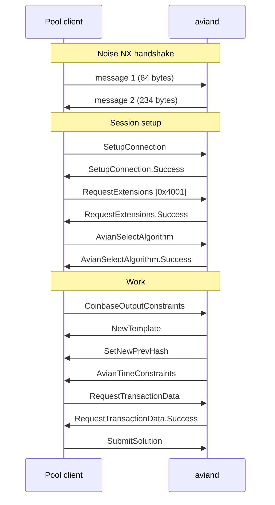
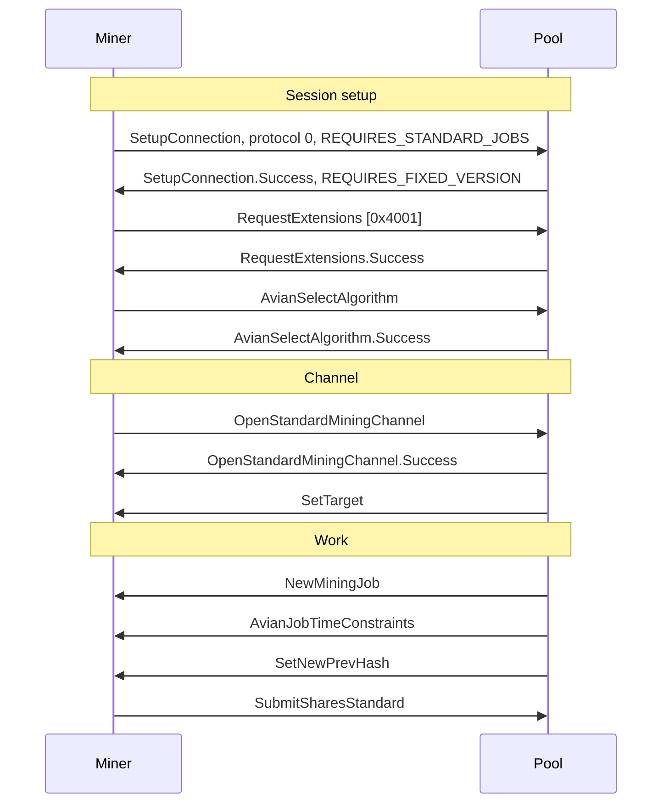
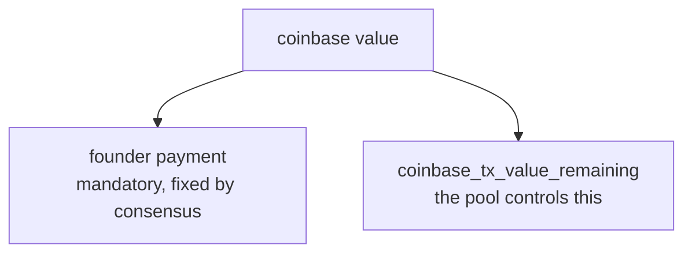

# Stratum v2 Template Provider

`aviand` can serve the Stratum v2 Template Distribution Protocol. This document
is both the operator guide and the specification of Avian's protocol extension,
because that extension is what a third-party pool or miner has to implement and
what a registry allocation request will freeze.

Nothing here is enabled by default, and a node started without `-sv2` behaves
exactly as it did before.

## What this is, and what it is not

`aviand` acts as a **Template Provider**. It builds block templates, announces
tip changes, serves transaction data, and accepts finished blocks. It is not a
pool: it has no concept of a worker, a share, a difficulty adjustment per miner,
or a payout.

| `aviand` | separate pool process |
| --- | --- |
| block construction | worker management |
| transaction selection | share difficulty and accounting |
| consensus rules | payouts |
| per-algorithm targets | the Stratum v2 Mining Protocol |
| founder payment | |
| template generation | |
| block submission | |

The existing JSON-RPC `getblocktemplate` and `submitblock` are untouched and
continue to work alongside this.

## Enabling it

```
-sv2                            serve the Template Distribution Protocol (default: off)
-sv2bind=<addr>[:<port>]        where to listen; repeatable (default: loopback)
-sv2port=<port>                 default port for binds that omit one
-sv2allowip=<ip>                subnet allowed to connect; repeatable
```

Default ports are 8442 (mainnet), 18442 (testnet), 28442 (testnet4), 38442
(signet) and 18447 (regtest).

Algorithms and protocol policy:

```
-sv2powalgo=<algo>              x16rt or minotaurx; repeatable. The first given is
                                used by a client that does not select one.
-sv2extensionpolicy=<policy>    require, optional or off (default: require)
-sv2maxrejects=<n>              drop a client after this many refused solutions
-sv2maxtemplates=<n>            templates kept live per client (default: 3)
```

Timing and limits:

```
-sv2interval=<n>                seconds between refreshes when the tip has not moved
-sv2ntimeforward=<n>            how far above a template's own timestamp ntime may roll
-sv2timemargin=<n>              margin left below the consensus future-time limit
-sv2maxclients=<n>
-sv2maxclientsperip=<n>
-sv2handshaketimeout=<n>
-sv2maxsendbuffer=<n>           MiB; must hold one whole block
```

Keys, which are generated mode 0600 on first run:

```
-sv2staticprivkey=<file>        default: <datadir>/sv2_static_key
-sv2authoritykey=<file>         default: <datadir>/sv2_authority_key
-sv2certvalidity=<n>            certificate lifetime in days
```

## Security

**Exposing the Stratum v2 port is equivalent to exposing an RPC port.** It
binds to loopback by default, and that default should be changed only
deliberately.

The Noise NX handshake authenticates the **server to the client**, not the
client to the server. A client learns that it is talking to a node holding a
static key endorsed by the pool authority key; the node learns nothing about the
client. Noise is therefore transport security, not access control. Use
`-sv2allowip`, which is checked at accept time before any cryptography runs.

There is **no cheap pre-filter for Avian's proof of work**. SHA256d chains let a
server do a quick partial check before committing to real work, but X16RT and
MinotaurX have no such form: the only way to know whether a submission is valid
is to compute the whole hash. The node's defence is the validation ladder in
`src/sv2/solution_check.cpp`, which rejects on every cheap field check first, a
rate limit on submissions, and the loopback default. If the port is exposed to
an untrusted network, those three are the whole defence.

## Session flow



`SetupConnection.protocol` must be 2 (Template Distribution).
`AvianSelectAlgorithm` is sent once per connection, after
`RequestExtensions.Success` and before `CoinbaseOutputConstraints`. The
algorithm is immutable thereafter, because one connection carries one `nBits`
and `target` stream.

`CoinbaseOutputConstraints` must arrive before the node will issue a template,
because the coinbase size and sigop budget it declares are what the block
assembler reserves. Under-declaring it is not reported: the finished coinbase
then fails the canonical re-serialization check in `SubmitSolution` and the
submission is refused, which the protocol gives no way to explain.

Two refusal behaviours a client has to expect, neither of which is an error
reply it can simply read and carry on from:

- **`algo-already-selected` is followed by a disconnect.** The node answers the
  second `AvianSelectAlgorithm` and then closes, because a client confused
  about which algorithm it selected cannot be served safely.
- **A malformed extension message gets no reply at all.** A frame whose payload
  does not decode, including one with trailing bytes, is logged and the
  connection is closed. There is no error message for "I could not parse that",
  since replying would require knowing what was meant.

Both are visible under `-debug=sv2` and only there.

One naming note for anyone building on the Stratum v2 Reference
Implementation: the specification names `SetNewPrevHash`'s third field
`ntime_start`, in both the Template Distribution and Mining Protocols, and that
is what this document and the node use. SRI's Rust struct calls the same field
`header_timestamp`. The bytes are identical; only the label differs.

`SetNewPrevHash` accompanies a template built on a tip the client has not seen.
An in-place refresh that picks up new fees sends only `NewTemplate` and
`AvianTimeConstraints`, so a client must not assume a fixed number of messages
per round of work.

The cryptography is the Stratum v2 spec's `Noise_NX_Secp256k1+EllSwift_ChaChaPoly_SHA256`
unchanged. Its key agreement is BIP324's `v2_ecdh`, down to the
`bip324_ellswift_xonly_ecdh` tag and the role-dependent key ordering.

## The Avian extension

`extension_type = 0x4001`, negotiated through the standard Extensions
Negotiation extension `0x0001`.

> **0x4001 is temporary and MUST NOT be used for production deployments.**

The Stratum v2 specification reserves `0x4000`–`0x7fff` for experimental use and
states that experimental values must not be present in production equipment.
A registry allocation at stratumprotocol.org is therefore a **mainnet release
blocker**, not a nice-to-have. Until one is assigned, this extension is suitable
for development, regtest and testnet only.

`-sv2extensionid` can override the identifier for interoperability testing. It
is hidden, validated `<= 0x7fff`, and **rejected on mainnet**, so a mainnet
node's wire identity is fixed by the constant alone.

The extension spans **both** the Template Distribution Protocol, which is what
`aviand` serves, and the Mining Protocol, which a pool serves to its workers.
Those are different links, but they need the same two things from Avian, for
the same reasons, so one extension covers both. `aviand` implements the
Template Distribution half; the Mining Protocol half is specified here and is
the pool's to implement.

### Why an extension is needed at all

Stock Template Distribution already carries most of what Avian needs.
`NewTemplate.version` contains `pow_type << 16`, and `SetNewPrevHash.nbits` and
`.target` are already per-algorithm. Three things are missing, and each is one
field:

1. A client cannot **ask** for an algorithm. Without that the node can only pin
   one per listening port.
2. There is no **upper bound on ntime**. The spec defines only
   `ntime >= ntime_start`. X16RT's hash chain is derived from
   `SHA256d(nTime & 0xffffff80)`, so a miner rolling ntime past a 128-second
   boundary silently computes the wrong hash function.
3. There is no way to tell a client **which version bits it may roll**. BIP320's
   mask covers bits 13–28, which fully contains Avian's algorithm field at bits
   16–23.

Every one of those failure modes is silent. A miner hits none of them as an
error; it just burns hashrate and looks unlucky. That is why the extension is
required by default rather than optional.

The first two recur verbatim on the Mining Protocol. A worker has to be told
which algorithm its connection carries, and a job carries an `ntime_start` but
no maximum permitted `ntime`, so an X16RT miner rolling off the end of a job's
epoch computes the wrong hash function there too. The third does not: the
algorithm is fixed per connection, so one `version_rolling_mask` covers every
job on it.

### Messages

All integers are little-endian, as everywhere in Stratum v2.

| `msg_type` | Message | Direction | Protocol |
| --- | --- | --- | --- |
| `0x00` | `AvianSelectAlgorithm` | downstream → upstream | both |
| `0x01` | `AvianSelectAlgorithm.Success` | upstream → downstream | both |
| `0x02` | `AvianSelectAlgorithm.Error` | upstream → downstream | both |
| `0x03` | `AvianTimeConstraints` | upstream → downstream | template distribution |
| `0x04` | `AvianJobTimeConstraints` | upstream → downstream | mining |

"Upstream" is the node for a pool, and the pool for a worker. The three
`AvianSelectAlgorithm` messages are identical on both protocols: they are
connection-scoped and carry nothing protocol-specific. Only the time
constraints differ, because the two protocols name work differently.

**`AvianSelectAlgorithm`**

| Field | Type | Meaning |
| --- | --- | --- |
| `pow_type` | `U8` | 0 = X16RT, 1 = MinotaurX |

**`AvianSelectAlgorithm.Success`**

| Field | Type | Meaning |
| --- | --- | --- |
| `pow_type` | `U8` | the algorithm now bound to this connection |
| `version_rolling_mask` | `U32` | bits of `nVersion` the client may change |

`version_rolling_mask` is **always `0`**, and there is no option to change it.
A client must submit `version` exactly as the template gave it.

The field exists, and `CheckSolution` honours a non-zero value, so a later
protocol version can allow rolling without a format change. Nothing in this
version can turn it on, because there is no durable safe subset of `nVersion`
to open. Bits 16–23 hold the algorithm, so rolling them either trips
`bad-algo-id` or silently moves the share to the other algorithm and the wrong
proof-of-work limit. Bits 29–31 are `VERSIONBITS_TOP_MASK`, which Avian also
uses to signal assets. What remains is BIP9 deployment space, where bits 2, 11,
12 and 28 are already assigned and the rest is where the next deployment will
land, so a mask chosen as safe today would not stay safe.

Set against that, rolling buys Avian nothing. Version rolling exists to give
ASICs search space beyond nonce and extranonce at very high hash rates, and
X16RT and MinotaurX are GPU and CPU algorithms where nonce plus extranonce is
ample.

**`AvianSelectAlgorithm.Error`**

| Field | Type | Meaning |
| --- | --- | --- |
| `error_code` | `STR0_255` | why the algorithm was refused |

Defined values:

| `error_code` | Meaning |
| --- | --- |
| `unsupported-pow-type` | not an algorithm this chain defines |
| `pow-type-not-enabled` | not an algorithm this node was configured to serve |
| `algo-already-selected` | a second selection on one connection |

These are normative. An extension whose only error message is "a `STR0_255`"
cannot be implemented against, and this is part of what a registry allocation
would freeze.

**`AvianTimeConstraints`**

| Field | Type | Meaning |
| --- | --- | --- |
| `template_id` | `U64` | the template these bounds apply to |
| `ntime_min` | `U32` | lowest acceptable `ntime`, inclusive |
| `ntime_max` | `U32` | highest acceptable `ntime`, inclusive |

Sent after every `NewTemplate`. Both bounds are **inclusive**, and they are
absolute values rather than a mask over `ntime_start`, because an in-place
refresh does not re-send `SetNewPrevHash` and so has nothing to anchor a mask
to.

`ntime_max` is the minimum of:

- X16RT only: the end of the template's 128-second epoch,
  `(nTime & 0xffffff80) + 127`
- `now + MAX_FUTURE_BLOCK_TIME_DUAL_ALGO - sv2timemargin`, where Avian's future
  limit is 1350 seconds, not Bitcoin's 7200
- `nTime + sv2ntimeforward`
- on chains that allow minimum-difficulty blocks, which is regtest and testnet,
  **`nTime` itself**: there `nBits` is a function of `nTime`, so rolling at all
  risks `bad-diff` even though the template's `nBits` was correct when issued

The node re-evaluates the future-time term when a solution arrives, so a
long-lived template cannot be used to smuggle a timestamp the chain would
reject.

**`AvianJobTimeConstraints`**

A **channel message**: bit 15 of `extension_type` is set, so this message
appears on the wire under `0xc001` while the extension it belongs to is still
`0x4001`. Bit 15 is the `channel_msg` flag and is ignored when an
implementation looks up which extension a message belongs to.

| Field | Type | Meaning |
| --- | --- | --- |
| `channel_id` | `U32` | the channel these bounds apply to |
| `job_id` | `U32` | the job these bounds apply to |
| `ntime_min` | `U32` | lowest acceptable `ntime`, inclusive |
| `ntime_max` | `U32` | highest acceptable `ntime`, inclusive |

Sent after every `NewMiningJob` or `NewExtendedMiningJob`, before the worker
can be expected to have started on it. Both bounds are **inclusive**.

This is the same information as `AvianTimeConstraints` keyed differently.
`template_id` is a Template Distribution concept and has no meaning to a
worker, so the mining form keys on the channel and job that the worker was
actually given. It is a separate message rather than a reinterpretation of the
same field so that an implementation handling both links, such as a pool, can
never confuse a template id with a job id.

`ntime_min` restates the job's `ntime_start`, and the restatement is doing real
work rather than padding. Stratum v2 says of `ntime_start` that it is the
`nTime` at which hashing starts and that it **is not the consensus minimum**.
Avian's `ntime_min` is a different kind of statement: it is a lower bound on
what will be accepted, because below it the node refuses the submission. The
two carry the same number and mean different things, so the extension states
the one it enforces rather than leaving a worker to read a start value as a
rule. Carrying both bounds together also means a pool that computes the window
once cannot emit halves that disagree.

How it lines up with the job depends on whether the job is active:

```
active job, ntime_start present
    AvianJobTimeConstraints.ntime_min MUST equal NewMiningJob.ntime_start

future job, ntime_start absent
    the constraints MAY be sent with the job, if the bounds are known then
    otherwise they MUST be sent immediately before the SetNewPrevHash that
    activates the job
    either way, the ntime_start that SetNewPrevHash supplies MUST equal
    the ntime_min in force for that job
```

"Before the `SetNewPrevHash`", not after. A worker must never have an instant
in which a job is active and its `ntime_max` is unknown, because the only safe
thing it could do in that instant is idle. So the ordering is:

```
NewMiningJob                 future job
[AvianJobTimeConstraints]    optional here, if the bounds are known
...
AvianJobTimeConstraints      required here if not sent above
SetNewPrevHash               activates the job
```

A worker **must not** begin hashing an Avian job until it holds both the
applicable time constraints and the activation information.

Note that the node does the opposite on its own link, and deliberately.
`aviand` sends `NewTemplate`, then `SetNewPrevHash`, then
`AvianTimeConstraints` last. The asymmetry is not an oversight:

- A worker activated by `SetNewPrevHash` is required by Stratum v2 to start
  hashing immediately, so constraints arriving afterwards leave a real instant
  in which it is working without knowing when its work expires.
- A Template Distribution client is a pool, and it cannot do anything with a
  template until it has the whole round: the merkle path, the required
  outputs, the prev hash and the window all have to be in hand before it can
  build a single job. There is no equivalent instant.

Putting `AvianTimeConstraints` last on that link buys something instead. It
gives a work round an unambiguous terminator, which a blocking client needs,
because `SetNewPrevHash` is only sent when the tip moved and so cannot be used
to tell a new-tip round from an in-place refresh. `test_framework/sv2.py`
relies on exactly that: it reads until the constraints arrive and then knows
the round is complete.

A third case is the one a running pool meets most often and neither of the
above describes it: a channel that already has an active job, on a tip that has
just moved. Resolve it as the future-job case rather than the active one. Issue
a **new future job**, then its constraints, then the `SetNewPrevHash` that
activates it. Issuing an active job alongside a `SetNewPrevHash` would put the
activation and the constraints in the same breath and give a worker no moment
at which it holds one without the other.

That distinction is not optional to handle. Stratum v2 requires the first
`NewMiningJob` after a channel opens to be a future job, with `ntime_start`
unset, so every connection meets the second case before it ever meets the
first.

The same invariant already holds one link up, where `AvianTimeConstraints`
`ntime_min` equals the `ntime_start` in the `SetNewPrevHash` for that template.
`mining_sv2.py` asserts it, so a pool can rely on the node's two messages
agreeing and has only to preserve the property as it narrows.

A pool derives these bounds from the `AvianTimeConstraints` it received for the
template the job came from. It must **narrow, never widen, and never to
nothing**: on a chain that pins the window shut, which is regtest and testnet,
`ntime_min` already equals `ntime_max` and any narrowing at all leaves a worker
with no legal `ntime`. Treat an empty window as a protocol error and refuse to
issue the job rather than issuing one that cannot be worked. It must **narrow,
never widen**: the node will
refuse a solution outside its own window, and a worker that was told it had
more room than the node allows will mine work that cannot be submitted. Where a
pool holds a job open across a refresh it must re-send this message with the
new bounds.

### On the Mining Protocol

A pool serving Avian workers negotiates the same extension and then uses it on
each worker connection:



`AvianSelectAlgorithm` comes before `OpenStandardMiningChannel`, because the
channel's `nominal_hash_rate` and target only mean something once the algorithm
is known. One connection carries one algorithm, so a worker mining both opens
two connections. That is not a limitation worth engineering around: the two
algorithms have independent difficulty, independent targets and independent
job streams, and multiplexing them would make every one of those ambiguous.

### Flags on an Avian mining connection

Version rolling is a negotiated feature with a flag on each side, so stating
that it is "disabled" is not enough: the two roles set different flags, and a
pool that sets the wrong one has no contract at all.

Set by the **miner**, in `SetupConnection.flags`:

| Bit | Flag | Avian v1 |
| --- | --- | --- |
| 0 | `REQUIRES_STANDARD_JOBS` | **1**, the worker needs `NewMiningJob` |
| 1 | `REQUIRES_WORK_SELECTION` | 0, no Job Declaration |
| 2 | `REQUIRES_VERSION_ROLLING` | **0**, it must not demand rolling |

Set by the **pool**, in `SetupConnection.Success.flags`:

| Bit | Flag | Avian v1 |
| --- | --- | --- |
| 0 | `REQUIRES_FIXED_VERSION` | **1**, the version field is not negotiable |
| 1 | `REQUIRES_EXTENDED_CHANNELS` | 0, standard channels are the only kind |

`REQUIRES_STANDARD_JOBS` matters because without it a standard channel may be
served grouped or extended jobs. A worker that can only process `NewMiningJob`
has to say so.

`REQUIRES_FIXED_VERSION` is the enforceable half of "no version rolling". The
specification says that if the miner set `REQUIRES_VERSION_ROLLING` then the
pool **must not** set `REQUIRES_FIXED_VERSION`, which means the two are
mutually exclusive rather than one overriding the other. An Avian pool cannot
honour rolling at all, so a miner that demands it must be **refused** with
`SetupConnection.Error`, not answered and then quietly held to a fixed version.
Avian keeps the algorithm in `nVersion` bits 16–23, and rolling them changes
which algorithm, and so which proof-of-work limit, the share is judged under.

Note the asymmetry with the node link: Template Distribution defines no flags
at all, so `aviand` rejects any non-zero `SetupConnection.flags` with
`unsupported-feature-flags`.

### `SubmitShares.Error` codes an Avian pool must send

Stratum v2 defines `invalid-channel-id`, `stale-share`, `difficulty-too-low`
and `invalid-job-id`. An Avian pool has to refuse two things none of those
describe, and both are refusals this extension exists to make possible:

| `error_code` | Meaning |
| --- | --- |
| `invalid-version` | `version` differs from the job's, which `REQUIRES_FIXED_VERSION` forbids and which would move the share to the other algorithm's proof-of-work limit |
| `invalid-ntime` | `ntime` is outside the window `AvianJobTimeConstraints` gave for that job |

`error_code` is a `STR0_255`, so inventing values is legal, but a miner cannot
recognise one it has never been told about. Undocumented, these two sit exactly
where the algorithm and the `ntime` bound sat before this extension existed.
They are therefore normative here, as the `AvianSelectAlgorithm.Error` values
are.

### What a pool does with a worker that clears `REQUIRES_STANDARD_JOBS`

Refuse the connection with `SetupConnection.Error`. Stratum v2 has no code for
a flag whose **absence** is the problem: `unsupported-feature-flags` names
flags that are not supported, and the `flags` field is described as naming the
flag causing the error, so using it here is a stretch a miner cannot
disambiguate. Follow the precedent of `missing-declare-tx-data-flag` and send
`missing-standard-jobs-flag`.

A v1 Avian pool serves standard jobs only, so a worker that can process
extended jobs is not the problem; a worker that has not said it needs standard
ones may be served jobs through a group it cannot interpret.

### `user_identity`, and what a solo pool reads out of it

A solo pool pays the miner directly in the coinbase, so it needs an address
from the miner. `user_identity` in `OpenStandardMiningChannel` is where it
goes: `STR0_255`, comfortably more than an Avian address needs.

**The field carries `address.workername`, and nothing says so anywhere.**
Not Stratum v2, which gives `user_identity` no structure at all, and not this
document until now. Every miner in the field puts it there because Stratum v1
did, and a pool that did not know would try to parse the whole string as an
address and refuse every real miner it met. Split on the **first** dot: no
Avian address can contain one, since neither the base58 alphabet nor the
bech32 charset includes it, so the first dot is the unambiguous end of the
address and `address.rig.1` parses correctly. A bare address with no label is
valid too.

Avian's address versions are mainnet 60 and 122, every test network 111 and
196, and the bech32 prefixes are `avn`, `tavn` for testnet and signet,
`tavn4`, and `avnrt`. So **mainnet is the only network a base58 address can be
checked against**, and off mainnet a testnet address will be accepted by a
regtest pool. The bech32 prefix separates regtest and testnet4 but not testnet
from signet. This matters little in practice, because the case worth getting
right is a mainnet pool refusing a test address, and that one works.

A pool **must refuse a channel it cannot pay** rather than fall back to a
default, a burn address or the operator's own. A miner mistyping its address
and being quietly mined to someone else's is the worst failure a solo pool
has, and it is silent.

Stratum v2 gives `OpenMiningChannel.Error` only `unknown-user` and
`max-count-exceeded`, neither of which fits, so these are normative here:

| `error_code` | Meaning |
| --- | --- |
| `missing-payout-address` | `user_identity` carried no address |
| `invalid-payout-address` | the address did not decode or failed its checksum |
| `wrong-network-address` | a valid address for another network |
| `unsupported-address-type` | a type this pool cannot pay, such as segwit v1 |

A miner that cannot tell "your address is wrong" from "the pool is full" will
retry forever against a pool that will never serve it. That is the same shape
as the algorithm and the `ntime` bound before this extension existed, and it
is the third time the gap has appeared.

### Work does not survive a reconnect


A `job_id` is unique only within the connection that issued it. Both it and
`channel_id` come from a pool's own counters, and a pool that restarts them
on a new connection, which is the obvious implementation, will reissue id 1 to
mean something else.

So a miner **must discard work in flight when a connection drops**. A nonce
found for the old job 1, submitted after reconnecting against the new job 1,
is a share computed over a different header: a different merkle root at least,
since a new `channel_id` changes the coinbase extranonce. At any realistic
difficulty it is simply rejected, and the miner has wasted both the work and
the submission. On a chain whose target is its own floor, which is regtest,
it is accepted instead, and a pool's test suite will therefore not notice the
miner is submitting work it did not do for that job.

Neither this document's extension nor Stratum v2 itself says this anywhere,
and a miner author has no way to infer it. A pool can make itself harder to
misuse by not reusing job ids across connections, but the robust rule is the
miner's, because it holds whatever the pool does.

### Two things the protocol cannot enforce for the pool

- **The target is compared against Avian's proof-of-work hash**, X16RT or
  MinotaurX, not SHA256d. This is why `SetTarget` needs no Avian field and also
  why no unmodified Stratum v2 miner can work here.
- **The pool builds the coinbase**, so the pool is what has to satisfy the
  node's submission checks. "What a client must reproduce" below is the pool's
  contract with the node, not the worker's with the pool.

`AvianJobTimeConstraints` applies to extended channels too, unchanged: a job's
ntime window does not depend on who assembles the coinbase. Extended-channel
coinbase reconstruction, and how Avian's coinbase contract is enforced across
it, are **deferred** until extended channels are implemented. They are not a
simple extension of the standard-channel case: Stratum v2 defines
`coinbase_tx_prefix` and `coinbase_tx_suffix` without the BIP141 marker, flag
and witness data, and Avian's contract requires a specific witness stack and a
canonical byte-for-byte reconstruction, so the two have to be reconciled
deliberately rather than assumed compatible.

### Changing this extension

A registry allocation covers an `extension_type`, and the message numbers inside
it are Avian's to assign. So **adding** a message later needs no new allocation:
a future `0x05` is a compatible extension of this one, and an implementation
that does not know it will not have negotiated it.

What is not free is **changing** `0x00` through `0x04`. Their field layouts and
meanings are what third-party pools and miners will have compiled against, and
altering one silently is the same class of failure the extension exists to
prevent. Treat any such change as a new extension version with its own
identifier, not as an implementation detail.

## How long a template stays usable

A refresh supersedes a template but does not make it worthless. Work already
handed to a miner is still valid for the same tip, and Avian refreshes on the
same cadence as it produces blocks, so a pool always has jobs in flight when
one lands. The node therefore keeps the last `-sv2maxtemplates` templates per
client, three by default, and a solution against any of them is accepted.

What a pool can rely on:

- a template stays submittable for at least the next `-sv2maxtemplates - 1`
  refreshes on the same tip, which at the default settings is about ninety
  seconds
- a template whose tip has been superseded is dropped **immediately**, because
  no solution against it can produce a block that connects
- `RequestTransactionData` for a dropped id answers `stale-template` rather
  than `template-id-not-found`, so a client can tell "that work has expired"
  from "you invented an id"
- `SubmitSolution` for a dropped id is refused as `unknown-template`, and since
  the protocol has no error reply for a submission, the only trace is a
  `-debug=sv2` log line

Raising the limit is cheap. A template holds `CTransactionRef`, so retaining
one costs a vector of shared pointers rather than a second copy of the block,
and the serialized transaction list, which is the one member that is a real
copy, is released as soon as a template stops being the newest.

## What a client must reproduce

The node rebuilds the header from the template and the submitted coinbase, so a
client's coinbase has to match what it was told. All of this is checked before
any proof of work is computed:

- `coinbase_tx_version`, `coinbase_tx_locktime` and
  `coinbase_tx_input_sequence` exactly as advertised
- one input with a null prevout, and a `scriptSig` of 2 to 100 bytes that
  **starts with `coinbase_prefix`**, which is the BIP34 height push
- `vin[0]` witness stack of exactly one 32-byte zero item, the BIP141 reserved
  value
- every output in `coinbase_tx_outputs` present **verbatim**, with the witness
  commitment the highest-indexed output bearing the `aa21a9ed` magic
- the pool's own outputs may go **before or after** the required ones. The
  commitment check looks for the highest-indexed output *bearing the magic*, so
  an ordinary payout output cannot displace it wherever it sits, and the
  required-output check tests for presence rather than position
- output total no more than `coinbase_tx_value_remaining` plus the required
  outputs
- a canonical encoding: the node re-serializes and byte-compares

Two of those are stricter than consensus on purpose. Avian's **founder payment**
is checked only in `ConnectBlock`, not in `ContextualCheckBlock`, so a client
that dropped that output would otherwise produce a block the node accepts at
header level and relays before validation refuses it. The same is true of the
witness commitment. Rejecting both here turns a wasted block into a log line.

`coinbase_tx_value_remaining` is already net of the founder payment, so no
further subtraction is needed:



## Caveats

1. **No unmodified Stratum v2 client can validate an Avian share.** Avian's
   block hash is the X16RT or MinotaurX proof-of-work hash, not SHA256d, however
   byte-perfect the wire format is. Making the extension required is what turns
   that from a silent failure into an explicit one.
2. **`extension_type = 0x4001` is experimental.** Registry allocation is a
   mainnet release blocker. See above.
3. **Version rolling is unsupported** in this version, and not configurable.
   `version_rolling_mask` is always 0 and `REQUIRES_FIXED_VERSION` is always
   set on a mining connection.
4. **There is no cheap pre-filter for Avian's proof of work.** Rate limiting and
   the loopback default are the defence for that final hash.
5. **Exposing the Stratum v2 port is equivalent to exposing RPC.**
6. **There is no `SubmitSolution.Error` in the Template Distribution Protocol.**
   A refused solution can only be logged and counted, because inventing a reply
   message would break a stock client's dispatch. Run with `-debug=sv2` to see
   the reason. A client that keeps failing is dropped after `-sv2maxrejects`,
   since one rolling a field it was told not to will never find a valid block
   and has no other way of being told.
7. **A server cannot proactively announce a required extension.**
   `RequestExtensions.Error` is only a response, and it does name the required
   extension, so a client that negotiates the wrong thing can correct itself.
   A client that never negotiates at all can only be disconnected, with a log
   line and no on-wire explanation. That is the cost of `require`.

## Testing

```
build/bin/test_avian --run_test=sv2_messages_tests,sv2_noise_tests,sv2_transport_tests,sv2_options_tests,sv2_connman_tests,sv2_solution_check_tests,sv2_template_provider_tests
test/functional/mining_sv2.py
```

`test/functional/test_framework/sv2.py` is a complete Template Distribution
client in Python, built on the framework's existing BIP324 primitives. It is a
second reader of the wire format, and the starting point for anyone wanting to
drive the Template Provider from a script.

The regtest fork activates at genesis+1, so both algorithms are reachable there
and `mining_sv2.py` mines a block with each.
